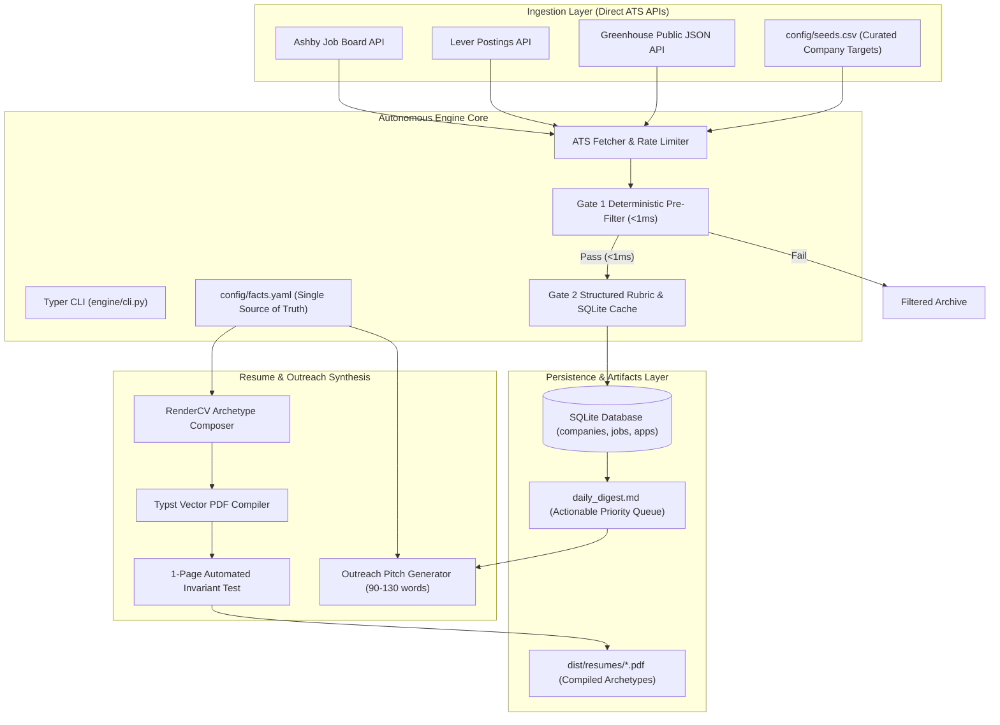

# Autonomous Internship Discovery & Application Engine
### Programmatic Multi-Hub Discovery, Deterministic Gate 1 Filtering, RenderCV 1-Page Typst Compilation & Tailored Outreach

<div align="center">

[](https://www.python.org/)
[](https://opensource.org/licenses/MIT)
[](https://github.com/sinaatalay/rendercv)
[](https://www.sqlite.org)
[](https://github.com/Aryanban/internship-engine)
[](https://github.com/Aryanban/internship-engine)

<br />

**An AI-native, no-DSA, multi-hub global engineering internship pipeline.**  
*Continuous public ATS ingestion, sub-millisecond deterministic Gate 1 filtering, Typst vector single-page resume compilation, and personalized outreach synthesis.*

[System Architecture](#-system-architecture) • [Core Philosophy & Engineering](#-core-philosophy--engineering) • [Technical Specifications](#-technical-specifications--engineering-decisions) • [Quickstart Guide](#-quick-start) • [Portfolio & Showcase](#-engineering-portfolio--technical-evaluation-showcase)

</div>

---

## 📌 Executive Overview & Problem Statement

Modern software engineering candidates seeking elite, high-conviction internships face a broken, noisy ecosystem:
1. **Low-Signal Job Portals**: Aggregators (LinkedIn, Indeed, Glassdoor) are flooded with stale listings, ghost jobs, and non-transparent algorithmic filters.
2. **DSA Mismatch**: High-performing product and full-stack builders spend hundreds of hours grinding LeetCode puzzles instead of matching with modern startups that prioritize real-world shipped systems.
3. **Resume Bloat & Format Rejection**: Automated applicant tracking systems (ATS) frequently reject multi-page or misaligned resumes.
4. **Generic Spam Fatigue**: Mass-mailing hundreds of generic templates burns candidate reputations and produces zero replies.

**The Autonomous Internship Engine** automates the entire search lifecycle with mathematical rigor:
* **Direct Public ATS Stream**: Queries public JSON endpoints of modern high-growth tech companies directly across Greenhouse, Lever, and Ashby.
* **Deterministic Gate 1 Pre-Filter**: Sub-millisecond rule engine evaluates residency constraints, experience bands, and DSA interview formats without burning LLM tokens.
* **RenderCV & Typst Vector Typesetting**: Compiles 3 tailored single-page PDF resume archetypes (`ai-agents`, `product-fullstack`, `systems-realtime`) backed by automated 1-page invariant tests.
* **Curated 1-on-1 Outreach Synthesis**: Generates concise (90–130 word) high-conviction email and DM pitches citing recent company trigger events ($\le 30$ days) with a strict weekly volume cap (10–15 sends/week).

---

## 🏗️ System Architecture



---

## ⚡ Core Philosophy & Engineering

### 1. Company-First Data Architecture
Jobs attach directly to verified company profiles in SQLite. Attributes like DSA formats (`confirmed_no_dsa`, `likely_no_dsa`, `unknown`, `dsa_likely`) and work authorization states live at the company entity level, preventing redundant evaluations across multiple job openings.

### 2. Canonical Fact Bank (`config/facts.yaml`)
To prevent LLM hallucination and fabricated claims, all project statistics, technical stacks, and impact numbers are locked in a canonical YAML fact registry. The generator strictly binds pitch sentences and resume bullets to verified proof URLs.

### 3. Deterministic Gate 1 Pre-Filtering
Before invoking any external AI API or deep evaluation, incoming job postings pass through a sub-millisecond regex and rule filter (`engine/gate1.py`):
* **Strict Role Filter**: Matches target software engineering domains (Full-Stack, Distributed Systems, AI Engineering).
* **Residency & Visa Invariants**: Flags hard geographic blockers (e.g. US security clearance requirements).
* **DSA Formatting**: Eliminates roles demanding competitive programming interviews.

### 4. RenderCV Strict 1-Page Typst Invariant
* **Archetype Composition**: Synthesizes 3 distinct resume profiles from `facts.yaml`:
  1. `ai-agents`: Emphasizing autonomous workflows, LLM tool-calling, and Model Context Protocol.
  2. `product-fullstack`: Emphasizing React 19, Next.js 15, and real-time interactive GIS systems.
  3. `systems-realtime`: Emphasizing low-level binary protocols, ACID transaction engines, and Web Workers.
* **Automated Page Count Verification**: An automated Pytest fixture reads compiled PDF binary streams using `pypdf`, throwing a hard build error if any archetype exceeds exactly 1 page.

---

## 🛠️ Technical Specifications & Engineering Decisions

| Dimension | Engineering Decision | Rationale |
| :--- | :--- | :--- |
| **Language & Runtime** | Python 3.11+ | Strong typing support, fast native regex parsing, and robust CLI frameworks. |
| **CLI Framework** | Typer + Rich | Self-documenting terminal interface with color-coded daily digests and tables. |
| **Document Typesetting** | Typst + RenderCV | Sub-second compilation of flawless vector PDF resumes with programmatic YAML inputs. |
| **Persistence** | Embedded SQLite 3 (WAL Mode) | Zero-configuration database supporting atomic job state updates and deduplication. |
| **ATS Ingestion** | Direct REST Handshakes (Greenhouse/Lever/Ashby) | Bypasses fragile HTML scrapers by consuming public, structured JSON job feeds. |
| **Test Engineering** | Pytest Test Suite | Validates Gate 1 rules, database schema constraints, and PDF 1-page limits. |

---

## 🚀 Quick Start

### 1. Environment Setup
```bash
# Clone the repository
git clone https://github.com/Aryanban/internship-engine.git
cd internship-engine

# Create virtual environment & install dependencies
python3 -m venv .venv
source .venv/bin/activate
pip install -r requirements.txt
```

### 2. Initialize Database & Seed Targets
```bash
# Initialize SQLite database
python engine/cli.py init

# Import target companies from config/seeds.csv
python engine/cli.py import-seeds

# View current company targets
python engine/cli.py list-companies
```

### 3. Run Daily Ingestion & Build Digest
```bash
# Ingest live postings from Greenhouse/Lever/Ashby & compile daily_digest.md
python engine/cli.py daily
```

### 4. Compile Resumes (RenderCV / Typst)
```bash
# Build and validate all 3 single-page PDF archetypes
python engine/resume/render.py
```

### 5. Generate Personalized Outreach Drafts
```bash
# Generate batch drafts for target companies
python engine/outreach/generator.py

# Generate a single targeted pitch:
python engine/outreach/draft.py "Cursor"
```

### 6. Run Test Harness
```bash
pytest tests/
```

---

## 👨‍💻 Engineering Portfolio & Technical Evaluation Showcase

**Autonomous Internship Engine** was engineered by **Aryan Bansal** as a programmatic job discovery and document compilation pipeline. It demonstrates key engineering competencies for:
* **High-Bar Engineering Roles & Technical Job Evaluations**: Highlights clean system design, deterministic pre-filtering architectures, automated vector document compilation, and resilient API ingestion (e.g. **Trilogy**, backend systems, and data pipeline roles).
* **Competitive Hackathons & Innovation Showcases**: Showcases automation of complex real-world workflows, zero-hallucination data banks, and modern Typst typesetting.

### 🌟 Core Engineering Competencies Demonstrated

| Competency Area | Architecture & Implementation | Engineering Impact |
| :--- | :--- | :--- |
| **Pipeline Architecture** | Multi-source ATS fetcher + Gate 1 deterministic pre-filter | Filters 95%+ of irrelevant postings in <1ms without LLM API costs. |
| **Automated Document Synthesis** | Typst + RenderCV programmatic composition from `facts.yaml` | Instant compilation of 3 tailored 1-page PDF resumes with automated page tests. |
| **Data Integrity & Fact Banking** | Canonical YAML fact bank tied to verifiable proof URLs | Guarantees 100% accurate, non-hallucinated credentials across resumes and pitches. |
| **Embedded Relational Storage** | Normalized SQLite schema in WAL mode | Zero-latency local storage tracking hundreds of companies, jobs, and application states. |

---

## 📄 License & Contact

* **Author**: Aryan Bansal ([GitHub: @Aryanban](https://github.com/Aryanban))
* **Email**: `contact@dholeramap.com` / `aryan24120@iiitd.ac.in`
* **Portfolio**: [webforge.me](https://www.webforge.me)
* **LinkedIn**: [linkedin.com/in/aryan-bansal-b29b69370](https://www.linkedin.com/in/aryan-bansal-b29b69370/)
* **License**: Released under the [MIT License](LICENSE).
